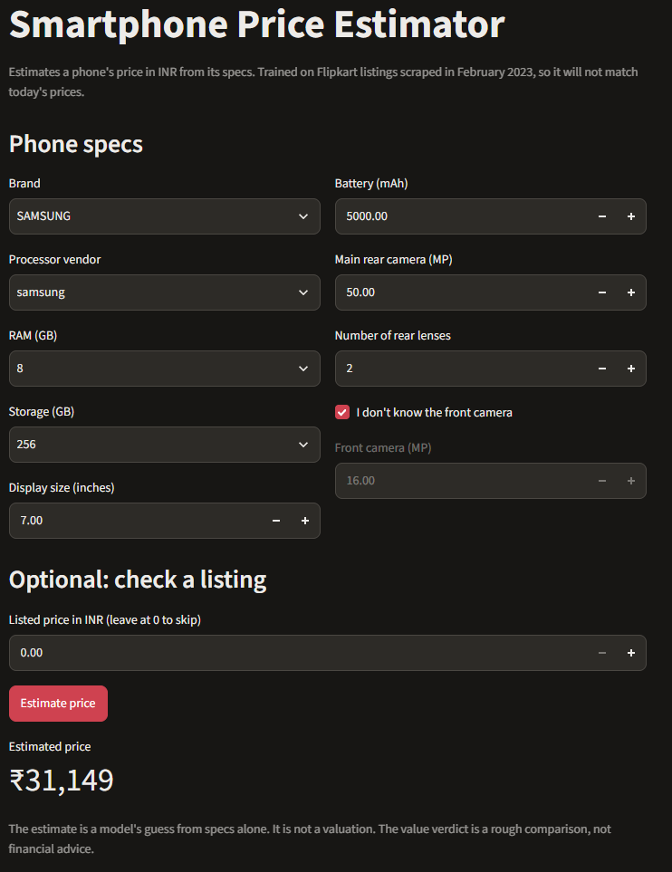

# Smartphone Price Estimator (Flipkart listings, 2023)

A Streamlit app that estimates a smartphone's price in INR from its specifications, and gives a rough good, fair or poor value verdict for a listed price.

**Important:** the data was scraped in February 2023. The estimates reflect prices from that time, not today's market.

## Problem

Phone prices vary widely for similar specs, and a buyer rarely knows whether a listing is fairly priced. This project learns the relationship between specs and list price from Flipkart listings, then uses it to estimate a price and compare it with a listed price.

## Dataset

- **Source:** Flipkart smartphone listings on Kaggle, by dnyaneshyeole (as stated on the dataset page; I haven't independently verified the source).
- **Scraped:** 26 February 2023.
- **Size:** 836 rows, 16 columns, one row per listing variant (colour, RAM and storage combinations).
- **Target:** `original_price` (INR).

## Cleaning

Every decision is made in `src/clean_data.py`, which prints the row count at each step.

| Step | Rows removed | Reason |
|---|---|---|
| Exact duplicate rows | 2 | Scraping repeats |
| Discounted price above original price | 20 | Impossible, so the scrape is wrong |
| Missing memory, storage, battery or rear camera | 84 | Imputing these would invent specs |

- **Front camera:** 122 listings have no front camera information. Rather than drop them, I kept them, filled `front_mp` with the median (12 MP), and set `front_camera_missing = 1` so the filled value can be identified.
- **Processor:** free text is reduced to a vendor category (Qualcomm, MediaTek, Unisoc, Samsung, Google, Apple, other, unknown). Model numbers are dropped because they aren't comparable across vendors.
- **Rear camera:** reduced to the main sensor's megapixels and the number of lenses.
- **Removed columns:** `ratings`, `rating_count` and `reviews` (not specs, and unknown for a phone that hasn't been listed yet); `colour` (no spec value); `battery_type` (43% missing).

After cleaning: **730 rows across 283 phone models.**

## Method

- **Split:** 80% train, 20% test, grouped by phone model, so the same phone never appears in both. Train: 599 rows, 226 models. Test: 131 rows, 57 models.
- **Target transform:** the model learns log(price), because prices are strongly right-skewed. Predictions are converted back to rupees before scoring.
- **Models:** linear regression (baseline), random forest and gradient boosting.
- **Model selection:** 5-fold cross-validation on the training set only, grouped by model. The test set is used once, for the final scores.

## Results

| Model | CV RMSE (INR) | Test RMSE (INR) | Test MAE (INR) | Test R² |
|---|---|---|---|---|
| Linear regression (baseline) | 8,975 | 5,114 | 3,744 | 0.63 |
| Random forest | 6,535 | 3,701 | 2,567 | 0.80 |
| **Gradient boosting** (saved) | **6,453** | **3,521** | **2,390** | **0.82** |

Gradient boosting was best on both cross-validation and the test set, and is the model the app uses. A typical prediction is about ₹2,400 from the listed price, which is about 13% of the median price (₹17,999).

## App

Run it with `streamlit run app.py`. Enter a phone's specs and press **Estimate price**. Optionally, enter a listed price to see a verdict:

- Within ±10% of the estimate: **fair**.
- More than 10% below: **good value**.
- More than 10% above: **poor value**.

The ±10% band is a rule of thumb, not a statistically derived threshold.



## Limitations

- **Out of date:** prices are from February 2023, so the estimates will not match current prices.
- **Listings, not sale prices:** the model predicts list price from specs. It doesn't account for seller, location, stock or discounts.
- **Small dataset:** 730 rows is modest, and the test set has only 131 rows, so the scores have real uncertainty.
- **Imputed front camera:** 122 phones have a median-filled front camera. This may understate the difference between phones with and without an unusual front camera.
- **Not validated on new phones:** the test set holds out whole models, but all of them are from the same 2023 listings. Performance on phones released later is unknown.
- **Verdict is a heuristic:** the good/poor value labels compare a listed price with the model's estimate. They are not investment or purchase advice.

## Reproduce

Put `flipkart_smartphones.csv` in the `data/` folder (not committed to git), then:

```bash
pip install -r requirements.txt
python -m src.clean_data
python -m src.train
streamlit run app.py
```

## Next steps

- Check the estimates against phones released after February 2023.
- Compare against a simpler model that uses only memory and storage, to see how much the other specs add.
- Normalise brand and vendor labels (for example "GOOGLE" and "google") so the dropdowns are clean.
- Add a test for the cleaning steps.
- Deploy the app to Streamlit Community Cloud.